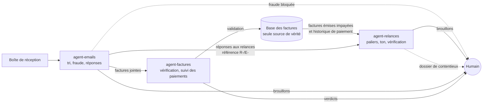

# Suite d'agents IA pour PME

**Trois agents IA qui prennent en charge l'administratif d'une PME, de l'email reçu à l'argent encaissé. Le code décide et vérifie, les modèles lisent et rédigent, un humain valide chaque décision.**

Pendant plus de cinq ans, j'ai géré deux centres de santé. Une bonne partie de mes semaines passait à trier des emails, saisir et vérifier des factures, et relancer ceux qui ne payaient pas. Ces trois projets répondent à ces trois corvées. Ils sont autonomes, mais conçus pour fonctionner ensemble.


## Les trois agents

| | Ce qu'il fait | Résultat clé mesuré | Coût |
|---|---|---|---|
| **[agent-factures](https://github.com/micouaidan55/agent-factures)** | Lit les factures (PDF, scans), extrait les données, repère TVA incohérente, doublons et échéances dépassées, suit les paiements | 40 documents : 100 % des champs extraits, 14/14 anomalies détectées, aucune fausse alerte | 0,03 $ par facture |
| **[agent-emails](https://github.com/micouaidan55/agent-emails)** | Trie la boîte de réception, extrait l'essentiel, transmet les factures jointes, bloque les fraudes, prépare les réponses | 48 emails : 97,6 % de tri correct, 6/6 fraudes détectées, 1 fausse alerte | 0,01 $ par email |
| **[agent-relances](https://github.com/micouaidan55/agent-relances)** | Relance les impayés au bon palier et au bon ton, comprend les réponses des clients, propose des échéanciers et prépare le dossier de contentieux pour l'avocat | 30 scénarios : 100 % de faits exacts, ton reconnu à l'aveugle 25/25 ; 48 réponses : 100 % d'actions correctes, 6/6 fraudes bloquées | 0,005 $ par relance, 0,001 $ par réponse |

Chaque projet a son README, sa démo, ses tests automatisés (plus de 800 au total, sans clé d'API) et une évaluation chiffrée reproductible.

## Comment ils se parlent



- **agent-emails → agent-factures** : chaque facture jointe à un email est analysée par l'agent de factures, réutilisé tel quel comme dépendance. Elle n'est enregistrée qu'après un clic humain.
- **agent-factures = la seule source de vérité** sur les factures et les paiements. Les deux autres projets ne la modifient jamais en dehors d'une validation humaine.
- **agent-factures → agent-relances** : l'agent de relance lit, en lecture seule, les factures émises non payées et l'historique de paiement, qui sert à choisir le ton.
- **agent-emails → agent-relances** : chaque relance porte une référence dans son objet (`[Réf. R-00042]`). Quand le client répond, agent-emails reconnaît la référence et laisse la réponse à agent-relances, sauf si elle paraît frauduleuse. agent-relances la rattache au client, Claude la lit, le code propose une action (report, suspension, échéancier) et un humain confirme.

## Une même philosophie produit

- **Le bon outil à la bonne place.** Un agent quand il faut choisir ses contrôles (factures), un pipeline quand les étapes sont connues (emails), des règles en code quand tout doit être identique pour chaque client (relances).
- **Le code vérifie ce qui doit être exact.** Montants, TVA, signaux de fraude, faits d'une relance : vérifiés par du code testé, pas laissés au modèle.
- **L'humain garde la main.** Rien n'est envoyé, payé ou enregistré sans validation.
- **Le modèle se choisit par la mesure.** Haiku suffit pour trier les emails et pour lire les réponses des clients (même action finale que Sonnet, 2,8 fois moins cher) ; pour rédiger une relance, il manque l'objectif de ton (84 %), donc Sonnet reste le choix par défaut.

## Faire tourner les trois sur une base commune

```bash
mkdir suite-pme && cd suite-pme
git clone https://github.com/micouaidan55/agent-factures.git
git clone https://github.com/micouaidan55/agent-emails.git
git clone https://github.com/micouaidan55/agent-relances.git
```

Dans chaque dossier, copier `.env.example` en `.env` et renseigner `ANTHROPIC_API_KEY`. Puis faire pointer les deux autres projets vers la base d'agent-factures :

```
# agent-emails/.env et agent-relances/.env
AGENT_FACTURES_DB=../agent-factures/data/factures.db
# agent-relances/.env : la boîte où arrivent les réponses des clients
AGENT_RELANCES_INBOX=../agent-emails/inbox
```

Dans `agent-relances/.env`, vider `TODAY` pour travailler à la date du jour. Lancer chaque application depuis son dossier avec `uv sync` puis `uv run streamlit run app/main.py --server.port <port>` (par exemple 8501, 8502 et 8503). Une facture reçue par email et validée apparaît alors dans le journal de l'agent de factures ; une facture émise impayée apparaît dans les relances du jour.

## Feuille de route

- Connecteurs Gmail et IMAP à la place du dossier de fichiers `.eml`.
- Mesure sur de vraies données anonymisées ; option de modèle local pour les données sensibles.

## Auteur

Michael Aidan, en reconversion vers un poste d'AI Product Manager. Master Informatique (Sorbonne Université, parcours agents), plus de cinq ans de gestion de centres de santé. Projets conçus, priorisés et évalués par moi, développés avec Claude Code.
